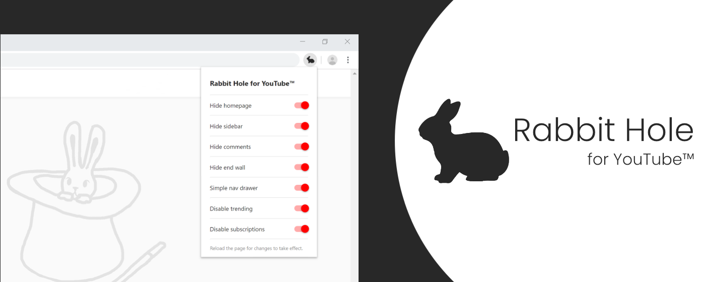
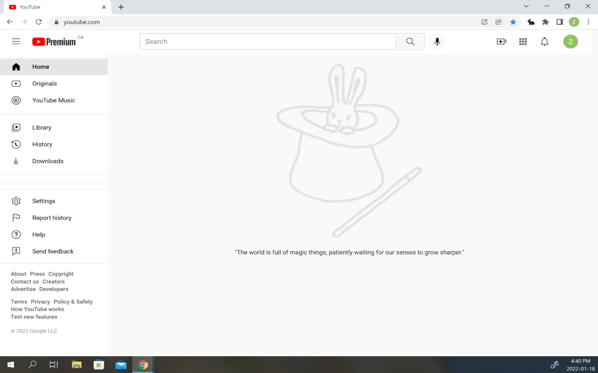
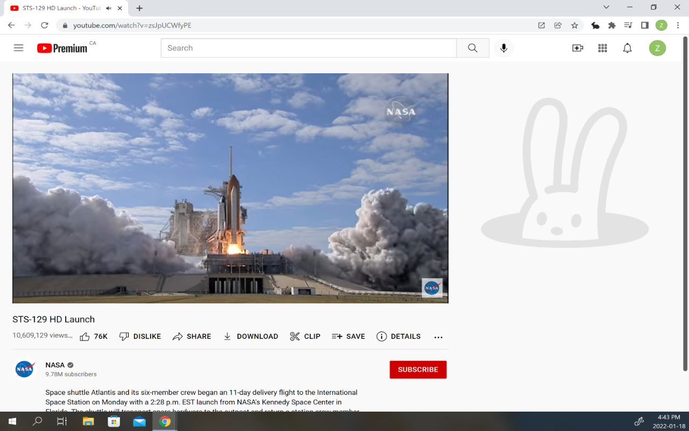
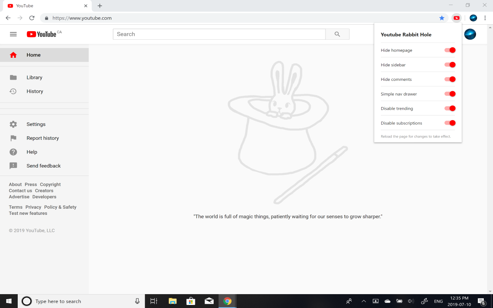

## Features

There is magic, but you have to be the magician. This extension allows you to take control of your time and reduce distractions while browsing YouTube in the following ways:

- Replace suggested content with cute bunnies!
- Hide comments (including livestream chats)
- Disable the trending and subscriptions pages
- Simplify the navigation drawer
- Disabling the wall of suggestions following a video
- Hiding banner-style ads to maintain a clean and distraction free environment

You can click the browser action in the toolbar to view and edit preferences.
 
## Screenshots

*Customizable Preferences*

## Install

The old store release uses Manifest V2 and no longer runs in current Chrome.
A Manifest V3 update must be published by the maintainer. In the meantime,
[download the updated source and follow the manual loading instructions](https://github.com/anthonyftwang/youtube-rabbit-hole#development).
The [Chrome Web Store listing](https://chrome.google.com/webstore/detail/youtube-rabbit-hole/nlddakjbmpidooplakalfoogdincflfh/)
will provide the normal installation path once the updated version is published.

## License
This open source project is licensed under the MIT License. View the source code [here](https://github.com/anthonyftwang/youtube-rabbit-hole)!
